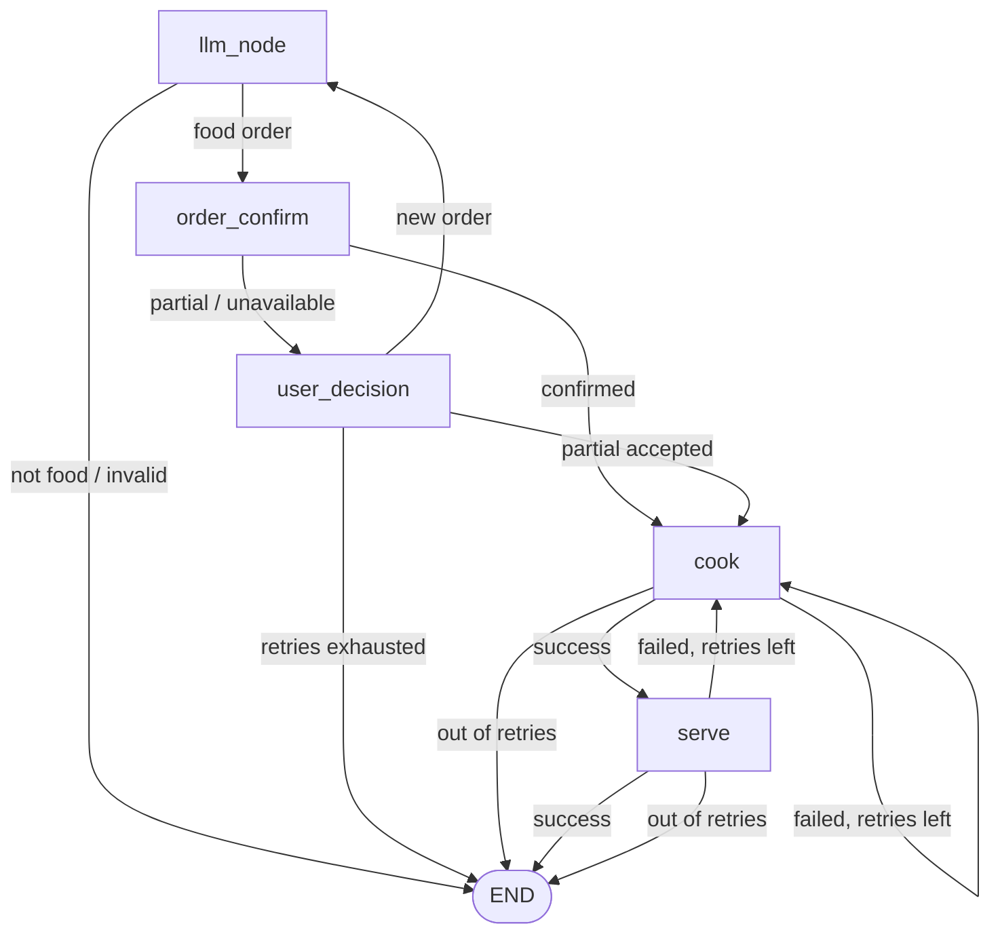

# Restaurant AI Agent (LangGraph Demo Project)

A restaurant order management agent built with [LangGraph](https://langchain-ai.github.io/langgraph/) and a Groq-hosted LLM (`openai/gpt-oss-120b`). The user types a food order, and the graph extracts the dish and quantity, checks stock, cooks, and serves, with retries at each stage.

## Features

- **Food-only guardrail**: the LLM rejects anything that isn't a food order.
- **Structured extraction**: `dish_name` and `required_quantity` are pulled out via Pydantic structured output.
- **Menu / stock check**: `MENU = {"burger": 10, "pizza": 20, "momos": 4}`. Orders are `confirmed`, `partial` or `unavailable`.
- **User decision loop**: for partial orders, choose `partial` (accept the available amount) or `new` (re-order). Limited by `order_retries` (3).
- **Cook simulation**: 60% success, up to `cook_retries` (2) attempts.
- **Serve simulation**: 80% success. If serving fails, the food is ruined and the graph loops back to `cook` (if retries remain).
- **LLM-written messages**: apology and success messages are generated by the LLM.

## Graph flow



## State

| Field | Description |
|---|---|
| `messages` | Conversation messages (`add_messages` reducer) |
| `dish_name` | Extracted dish |
| `required_quantity` | Quantity requested |
| `available_quantity` | Stock available (0 if not on menu) |
| `status` | `pending`, `confirmed`, `partial`, `unavailable`, `ready`, `complete`, `failed` |
| `order_retries` / `cook_retries` / `serve_retries` | Retry counters (3 / 2 / 2) |
| `final_result` | `True` if the order completed successfully |

## Setup

Requires Python 3.10+.

```bash
pip install langgraph langchain-core langchain-groq python-dotenv
```

Create a `.env` file (it is git-ignored) containing your Groq key:

```
GROQ_API_KEY=your_key_here
```

`load_dotenv()` searches upward from the script's folder, so the `.env` can live in this folder or a parent folder.

## Run

```bash
python restproject.py
```

Example session:

```
What would you like to order? (type 'quit' to exit): 2 pizza
[kitchen] Cooking succeeded.
AI: Your order of 2 pizzas has been served successfully. Enjoy your meal!
=== Order result: SUCCESS (status=complete) ===
```

Type `quit` or `exit` to stop.

## Project files

- `restproject.py`: the full LangGraph agent and console loop.
- `prompt.md`: the original specification the agent was built from.

## Notes

- Dishes not on the menu are reported as unavailable and the user is asked for a new order (no partial option).
- Each failed cook attempt, including re-cooks after a serve failure, consumes one `cook_retries`.
- The console loop uses `input()` inside the `user_decision` node; a production app would use LangGraph's `interrupt` instead.
